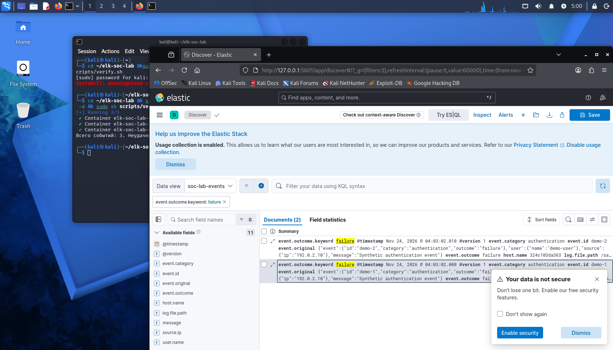

# Разбор событий входа в Kibana

Цель: проверить, что Logstash загрузил синтетические журналы в Elasticsearch и что их можно отфильтровать в Kibana.

1. Запусти `docker compose up -d` в папке проекта.
2. Проверь количество записей: `docker compose exec -T elasticsearch curl -fsS http://localhost:9200/soc-lab-events/_count`.
3. В Kibana создай Data View `soc-lab-*` без поля времени. В Discover добавь колонки `event.id`, `user.name`, `source.ip` и `event.outcome`.
4. Введи `event.outcome: failure`, запиши число результатов. Убери фильтр и проверь, есть ли успешный вход у того же пользователя.

Ожидается три события, из них две неудачные попытки входа. Эти данные сами по себе не доказывают компрометацию. Время загрузки не устанавливает порядок исходных попыток.

## Результат

На Kali Linux под VirtualBox скрипт проверки Elasticsearch вернул 3 события, из них 2 неудачных входа. В Kibana Discover представление `soc-lab-events` без ограничения по времени показало все 3 документа. Фильтр `event.outcome.keyword: failure` оставил `demo-1` и `demo-2`. В общем списке также виден успешный вход `demo-3`. Во всех трёх синтетических записях указаны `demo-user` и `192.0.2.10`.

Совпадение пользователя и адреса помогает связать записи для дальнейшей проверки. Для вывода об инциденте нужны исходные временные метки и контекст входа, например сведения об обычной активности пользователя.
